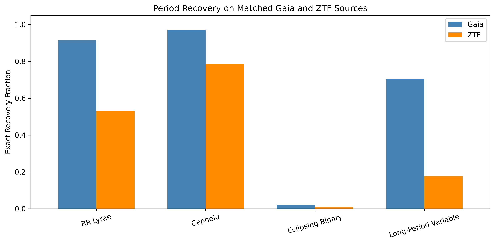
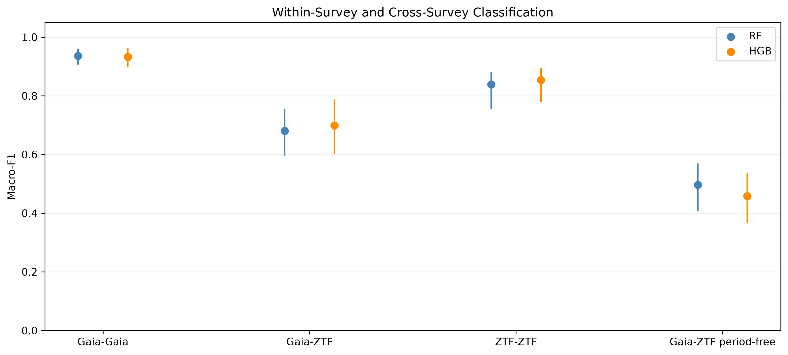

# Machine Learning Classification of Variable Stars Using Gaia DR3 Time-Series Photometry

Machine learning classification of 4 variable-star classes using astronomical time-series photometry, investigating feature importance, period recovery, and cross-survey generalization.


---

## Overview

### Problem Statement

Variable stars change brightness in repeating patterns, and each type (RR Lyrae, Cepheids, eclipsing binaries, long-period variables) tells astronomers something different. RR Lyrae and Cepheids are used to measure distances across the universe. ESA's Gaia telescope has observed far too many stars to classify by hand, and each star has only about 40 irregularly spaced brightness measurements, which makes period-finding unreliable.

### Research Question

How accurately can interpretable features extracted from sparse Gaia DR3 light curves classify these four variable-star types, and how much of the performance comes from the star's color and brightness versus the shape of its light curve?

### Key Contributions

- Gaia classification achieved 0.9737 macro-F1 and 97.38% accuracy using histogram gradient boosting.
- Time-domain features provide substantially more classification information than brightness and color alone.
- Classification remains effective despite inaccurate period recovery, with period-free Gaia models achieving up to 0.9376 macro-F1.
- Cross-survey evaluation on 551 matched Gaia and ZTF sources demonstrates substantial performance deterioration under survey transfer.
- Period-derived features improve cross-survey macro-F1 by 18.38–24.05 percentage points.

  


---

## Technical Approach

### Data

2,000 stars (500 per class) queried from Gaia DR3 class-specific tables via ADQL. About 90,000 epoch measurements were downloaded and filtered to 85,243. Every excluded star is accounted for (22 RR Lyrae had fewer than 20 epochs, leaving 1,978 for modeling).

### Features

About 45 features per star: magnitude statistics, Lomb-Scargle period and power, Fourier amplitude ratios, structure-function and timescale features, and BP-RP color. 

Gaia's published periods are used only for validation.

### Evaluation

- 5×5 repeated cross-validation grouped by HEALPix sky cell to reduce spatial leakage.
- Fixed HEALPix-grouped training (1,110), validation (419), and test (449) partitions, with source IDs stored in `splits/`.
- Fixed hyperparameters and 95% confidence intervals estimated using 1,500 sky-cell bootstrap replicates.
  
---

## Results

| Model | Macro-F1 |
|---|---|
| Dummy (stratified guessing) | 0.24 |
| Logistic Regression | 0.94 |
| Random Forest (primary) | 0.97 |
| Gradient Boosting | 0.97 |

| Random Forest feature set | Macro-F1 |
|---|---|
| Color + mean brightness only | 0.63 |
| Brightness statistics only | 0.63 |
| Time-domain (statistics + period + Fourier) | 0.93 |
| Time-domain + color | 0.95 |
| All feature families | 0.97 |


Errors are astrophysically sensible: short-period Cepheids are confused with RR Lyrae, and RR Lyrae with eclipsing binaries, where sparse sampling makes curves look alike. Long-period variables are nearly perfect because they are very red.

### Locked Test Results

Random Forest evaluated on 449 held-out sources.

| Metric | Score | 95% CI |
|---|---:|---:|
| Accuracy | 0.9822 | 0.9481–0.9920 |
| Macro-F1 | 0.9797 | 0.8089–0.9895 |
| Balanced Accuracy | 0.9795 | 0.9747–0.9926 |

Results are stored in `models/locked_test/`.

### ZTF Extension

ZTF DR24 r-band photometry was obtained for sources from the existing Gaia cohort. Of 1,978 Gaia modeling sources, 599 were matched and 551 retained after quality filtering.

Both surveys use the same feature extraction implementation, 20 shared predictors, and five-fold spatial cross-validation repeated five times across 75 HEALPix regions.

| Class | Matched | Eligible |
|---|---:|---:|
| RR Lyrae | 191 | 175 |
| Cepheid | 73 | 70 |
| Eclipsing Binary | 232 | 226 |
| Long-Period Variable | 103 | 80 |
| Total | 599 | 551 |

#### Period Recovery

Comparison restricted to 539 sources with searchable reference periods in both surveys.

| Class | Gaia | ZTF |
|---|---:|---:|
| RR Lyrae | 91.4% | 53.1% |
| Cepheid | 97.1% | 78.6% |
| Eclipsing Binary (half-period) | 74.3% | 56.2% |
| Long-Period Variable | 70.6% | 17.6% |



#### Cross-Survey Classification

| Experiment | RF Macro-F1 | HGB Macro-F1 |
|---|---:|---:|
| Gaia to Gaia | 0.9362 | 0.9330 |
| Gaia to ZTF | 0.6807 | 0.6988 |
| ZTF to ZTF | 0.8390 | 0.8534 |
| Gaia to ZTF (period-free) | 0.4969 | 0.4583 |



#### Paired Macro-F1 Differences

| Comparison | RF | HGB |
|---|---:|---:|
| Cross-survey change | -0.2555 | -0.2342 |
| ZTF training improvement | +0.1582 | +0.1546 |
| Period feature contribution | +0.1838 | +0.2405 |

All paired 95% spatial bootstrap confidence intervals exclude zero.

Cross-survey classification performance declines substantially relative to the matched Gaia baseline. Training directly on ZTF recovers much of this performance. Period-derived features remain valuable during survey transfer despite reduced agreement with catalog reference periods.

Results are stored in `models/ztf/`.

---
## Limitations

- Gaia DR3 catalog classifications are reference labels rather than independently confirmed ground truth.
- The selected Gaia cohort does not represent natural variable-star class frequencies.
- The locked Gaia test partition was established retrospectively after exploratory cross-validation.
- Sparse sampling, harmonic ambiguity, and restricted period-search ranges limit physical period recovery.
- The phase-drift agreement criterion depends on the observational baseline.
- The matched ZTF cohort represents 27.9% of the Gaia modeling population, with unequal coverage across classes.
- Cross-survey differences cannot be attributed independently to cadence, passband, or measurement noise.
- ZTF provides independent photometric observations but retains Gaia reference classifications.

---

## Reproducibility

Clone the repository and install the locked environment:

```bash
git clone https://github.com/sumaitate/gaia-varstars.git
cd gaia-varstars
uv sync --locked
shasum -a 256 -c data_sha256.txt
```

On Linux, `sha256sum -c data_sha256.txt` can be used instead.

Execute the notebooks in the following order:

| Order | Notebook |
|---:|---|
| 1 | `02_gaia_fe.ipynb` |
| 2 | `03_gaia_validation.ipynb` |
| 3 | `01_gaia_eda.ipynb` |
| 4 | `04_gaia_modeling.ipynb` |
| 5 | `05_ztf.ipynb` |

Skip the final live Gaia query cell in notebook `03` and use the frozen validation data.

Gaia and ZTF feature engineering share the implementation in `gaia_variable_stars/features.py`.

To reproduce the locked Gaia evaluation:

```bash
uv run --locked python scripts/locked_evaluation.py evaluate
```

To reproduce the ZTF extension after generating the Gaia features and validation tables:

```bash
uv run --locked jupyter nbconvert --to notebook --execute --inplace --ExecutePreprocessor.timeout=-1 notebooks/05_ztf.ipynb
```

Reference results are preserved in:

- `reproducibility/rank_reference.csv`
- `reproducibility/ztf_reference.csv`

The Gaia pipeline has been reproduced from a fresh clone. ZTF reproduction uses frozen photometry, fixed random seeds, shared feature definitions, and repeated spatial cross-validation.

### Data Acquisition

Frozen observations are provided for computational reproduction without requiring live archive queries.

To retrieve observations from the astronomical archives:

```bash
uv run --locked python -m gaia_variable_stars.dataset
uv run --locked python -m gaia_variable_stars.ztf_dataset
```

Live archive retrieval is separate from frozen-data reproduction and may return different observations if archive contents change.

---

## Repository Structure

```text
├── README.md
├── pyproject.toml
├── uv.lock
├── data_sha256.txt
├── data/
├── gaia_variable_stars/
│   ├── __init__.py
│   ├── config.py
│   ├── dataset.py
│   ├── features.py
│   └── ztf_dataset.py
├── notebooks/
│   ├── 01_gaia_eda.ipynb
│   ├── 02_gaia_fe.ipynb
│   ├── 03_gaia_validation.ipynb
│   ├── 04_gaia_modeling.ipynb
│   └── 05_ztf.ipynb
├── scripts/
│   └── locked_evaluation.py
├── splits/
│   ├── train_source_ids.csv
│   ├── validation_source_ids.csv
│   └── test_source_ids.csv
├── reproducibility/
│   ├── rank_reference.csv
│   └── ztf_reference.csv
├── models/
│   ├── locked_test/
│   └── ztf/
└── reports/figures/
```

---

## Acknowledgments

This is an undergraduate research project at the Borough of Manhattan Community College (BMCC), conducted under the supervision of Professor Iqram Hussain in the BFF research program.

Data: Gaia Collaboration, *Gaia Data Release 3*, Astronomy & Astrophysics 674 (2023). This work uses data from the European Space Agency (ESA) mission Gaia.

**Author:** Sumaitat Ebshar
