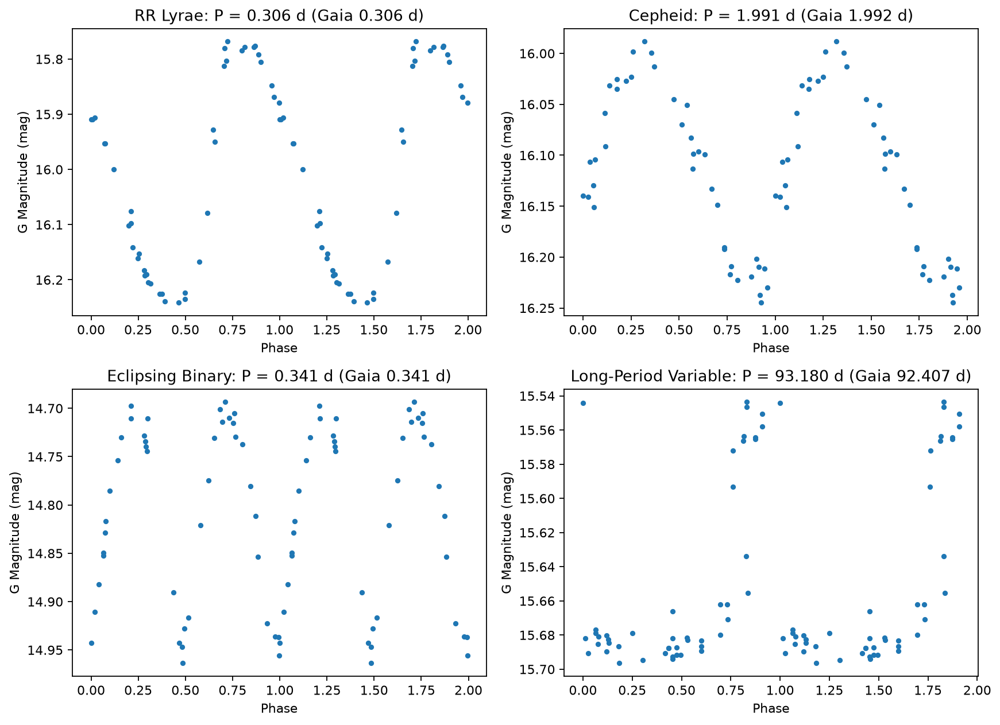
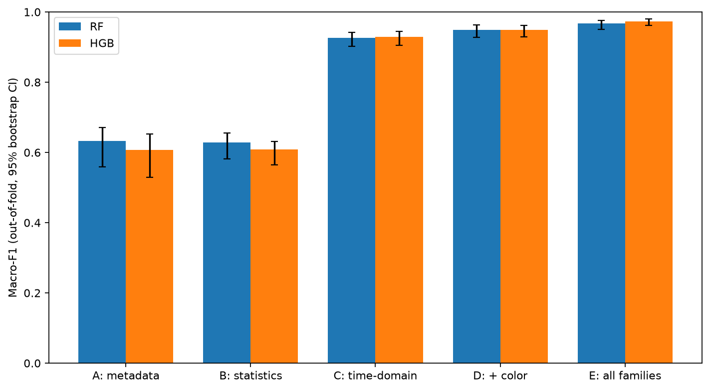

# Gaia Variable Star Classifier

**Sorting four types of variable stars from ESA's Gaia space telescope using only how their brightness changes over time.**

## Overview

Variable stars brighten and dim in patterns, and each type reveals something different about the universe (for example, distances to other galaxies). Gaia has observed far too many stars to sort by hand, so I built a pipeline that classifies **RR Lyrae, Cepheids, eclipsing binaries, and long-period variables** from sparse, irregularly timed brightness measurements.

The goal wasn't just accuracy. It was to find out **what is actually doing the work: the star's color, or the pattern in its light?**

## Results

| Model | Macro-F1 |
|---|---|
| Random guessing | 0.24 |
| Logistic Regression | 0.94 |
| **Random Forest** | **0.97** |
| Gradient Boosting | 0.97 |

- **Color + brightness alone:** ~0.63
- **Light-curve features alone:** ~0.93
- **Everything combined:** ~0.97

**Takeaway:** the shape of a star's light curve carries most of the signal. Color adds a smaller, measurable boost.

## What I built

- **Data pipeline:** queried the Gaia archive (ADQL), downloaded ~90k measurements for 2,000 stars, cleaned to 85k, and tracked every dropped star
- **Feature engineering:** ~45 features per star, including Lomb-Scargle periods, Fourier shape ratios, and timescale statistics
- **Period reliability test:** a false-alarm check so the pipeline refuses to report a period the data doesn't support
- **Period validation:** compared against Gaia's published periods, including half/double-period aliases (eclipsing binaries lock onto half the true period, as expected physically)
- **Modeling:** baselines, ablations, redundancy tests, and robustness checks by brightness, observation count, and label confidence

## Why the numbers can be trusted

- Sky-grouped cross-validation (5×5), so the model can't learn sky position
- Every score is out-of-fold, with no hyperparameter tuning
- 95% confidence intervals from a sky-cell cluster bootstrap
- Gaia's published periods are used only for validation, never as inputs

## Limitations

Labels come from Gaia's own classifier, the benchmark is balanced (real class frequencies differ widely), and it's Gaia-only. **Next:** external validation on ZTF.

