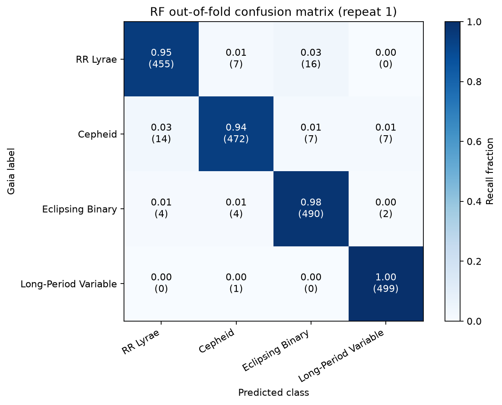

# Machine Learning Classification of Variable Stars Using Gaia DR3 Time-Series Photometry

Classifying 4 types of variable stars from sparse Gaia DR3 light curves, and testing whether color or light-curve shape drives accuracy.


---

## Overview

### Problem Statement

Variable stars change brightness in repeating patterns, and each type (RR Lyrae, Cepheids, eclipsing binaries, long-period variables) tells astronomers something different. RR Lyrae and Cepheids are used to measure distances across the universe. ESA's Gaia telescope has observed far too many stars to classify by hand, and each star has only about 40 irregularly spaced brightness measurements, which makes period-finding unreliable.

### Research Question

How accurately can interpretable features extracted from sparse Gaia DR3 light curves classify these four variable-star types, and how much of the performance comes from the star's color and brightness versus the shape of its light curve?

### Key Contributions

- **~0.97 macro-F1** (Random Forest, out-of-fold, 1,978 stars) against 0.24 for random guessing
- **Light-curve shape carries most of the signal:** color and brightness alone reach ~0.63, time-domain features ~0.93, everything combined ~0.97
- **Period reliability test:** a false-alarm check blanks period features when the data do not support a period
- **Period validation against Gaia:** eclipsing binaries mostly lock to half their true period, as expected for two eclipses per orbit, and this is reported rather than hidden


---

## Technical Approach

### Data

2,000 stars (500 per class) queried from Gaia DR3 class-specific tables via ADQL. About 90,000 epoch measurements were downloaded and filtered to 85,243. Every excluded star is accounted for (22 RR Lyrae had fewer than 20 epochs, leaving 1,978 for modeling).

### Features

About 45 features per star: magnitude statistics, Lomb-Scargle period and power, Fourier amplitude ratios, structure-function and timescale features, and BP-RP color. 

Gaia's published periods are used only for validation.

### Evaluation

- 5×5 repeated cross-validation grouped by HEALPix sky cell to reduce spatial leakage.
- Fixed HEALPix-grouped training (1,110), validation (419), and test (449) partitions, with source IDs stored in `splits/`.
- Fixed hyperparameters and 95% confidence intervals estimated using 1,500 sky-cell bootstrap replicates.
  
---

## Results

| Model | Macro-F1 |
|---|---|
| Dummy (stratified guessing) | 0.24 |
| Logistic Regression | 0.94 |
| Random Forest (primary) | 0.97 |
| Gradient Boosting | 0.97 |

| Random Forest feature set | Macro-F1 |
|---|---|
| Color + mean brightness only | 0.63 |
| Brightness statistics only | 0.63 |
| Time-domain (statistics + period + Fourier) | 0.93 |
| Time-domain + color | 0.95 |
| All feature families | 0.97 |



Errors are astrophysically sensible: short-period Cepheids are confused with RR Lyrae, and RR Lyrae with eclipsing binaries, where sparse sampling makes curves look alike. Long-period variables are nearly perfect because they are very red.

### Locked Test Results

Random Forest evaluated on 449 held-out sources.

| Metric | Score | 95% CI |
|---|---:|---:|
| Accuracy | 0.9822 | 0.9481–0.9920 |
| Macro-F1 | 0.9797 | 0.8089–0.9895 |
| Balanced Accuracy | 0.9795 | 0.9747–0.9926 |

Results are stored in `models/locked_test/`.

---

## Limitations

- Labels are derived from Gaia DR3 class-specific catalogs and are not independently confirmed.
- The approximately class-balanced benchmark does not reflect real Gaia class frequencies.
- The locked test partition was established retrospectively after exploratory cross-validation.
- External validation on ZTF is planned.

---

## Reproducibility

```bash
git clone https://github.com/sumaitate/gaia-varstars.git
cd gaia-varstars
uv sync --locked
sha256sum -c data_sha256.txt
uv run --locked python scripts/locked_evaluation.py evaluate
```

For the full analysis, execute the notebooks in order: `02`, `03`, `01`, `04`. Skip the final live Gaia query cell in notebook `03` and use the frozen validation data.

Local notebook execution and all four data checksums passed. Regenerated model rankings matched the reference results within `rtol=1e-5` and `atol=1e-6`. Fresh-clone reproduction remains unverified.

---

## Repository Structure

```text
├── README.md
├── pyproject.toml
├── uv.lock
├── data_sha256.txt
├── data/
├── gaia_variable_stars/
├── notebooks/
│   ├── 01_gaia_eda.ipynb
│   ├── 02_gaia_fe.ipynb
│   ├── 03_gaia_validation.ipynb
│   └── 04_gaia_modeling.ipynb
├── scripts/
│   └── locked_evaluation.py
├── splits/
│   ├── train_source_ids.csv
│   ├── validation_source_ids.csv
│   └── test_source_ids.csv
├── reproducibility/
│   └── rank_reference.csv
├── models/
│   └── locked_test/
└── reports/figures/
```
---

## Acknowledgments

This is an undergraduate research project at the Borough of Manhattan Community College (BMCC), conducted under the supervision of Professor Iqram Hussain in the BFF research program.

Data: Gaia Collaboration, *Gaia Data Release 3*, Astronomy & Astrophysics 674 (2023). This work uses data from the European Space Agency (ESA) mission Gaia.

**Author:** Sumaitat Ebshar
